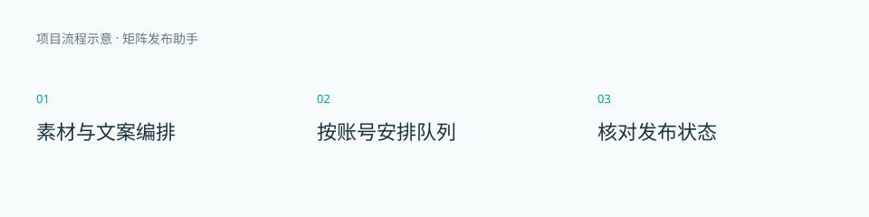

# 矩阵发布助手

多平台内容编排、账号管理与发布状态核对。

这是作品展示仓库，包含项目介绍与演示说明。应用源码、激活逻辑和安装包未在此发布。

## 使用流程

1. 素材与文案编排。
2. 按账号安排队列。
3. 核对发布状态。

## 当前边界

支持视频、封面、文案与账号分别配置；发布结果不明时需人工核对。平台登录、审核、长期登录和真实发布效果须按实际业务验证。

## 演示

参见 [演示说明](DEMO.md)。目前没有公开在线演示或下载链接。流程图为原创说明图，不是运行截图或真实业务结果。

作者：[栈上观川](https://github.com/dpbingnet)
